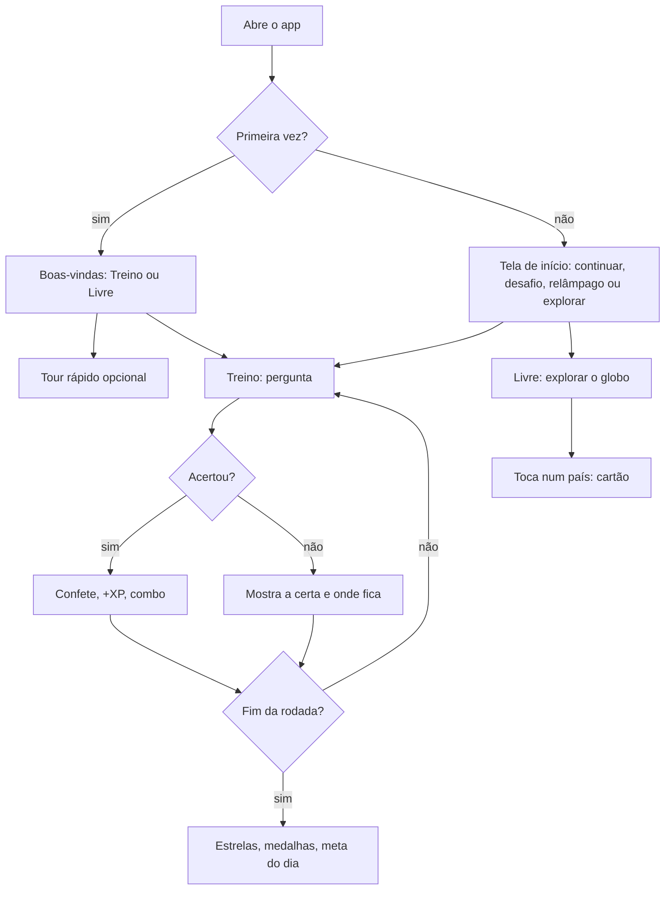

# geoTotal: Documento do Projeto v1 (15/10/2026)

Documento vivo do produto. Arquitetura, comandos e regras de código ficam em
[`ARQUITETURA.md`](ARQUITETURA.md); aqui ficam visão, escopo, backlog, decisões e riscos.

## 1. Visão

- **Problema:** aprender países, capitais, bandeiras e geografia costuma ser decoreba chata, com
  apps cheios de anúncio, que pedem permissão ou que só funcionam com internet.
- **Para quem:** estudantes (escola, vestibular, concurso) e curiosos de geografia, no celular Android.
- **Proposta:** um globo 3D bonito para explorar e um treino curto e divertido, gratuito, sem anúncios,
  sem internet e sem pedir nenhuma permissão.
- **Métrica de sucesso:**
  - quem instala volta no dia seguinte (sequência de dias / meta do dia);
  - nota da Play Store em 4,5 ou mais;
  - zero quebra de layout ou erro de JavaScript chegando ao artefato ou à loja (pego nos testes).

## 2. Mapa de entendimento

**Sabemos**
- App Android (WebView) publicado na Play Store; versão 1.40 (versionCode 46) enviada para revisão.
- Também roda como página única (artefato do Claude) a partir de `web/geototal.html`.
- Celular de referência do dono: Motorola Edge 60 Pro (450px de largura, tema escuro, Roboto).
- Sem dinheiro real, apostas ou compras no app. Sem anúncios. Sem login.
- Dois modos: **Treino** (perguntas, XP, medalhas, passaporte) e **Livre** (explorar o globo).

**Premissas**
- P1. A maior parte do público joga em celular na vertical, com uma mão.
- P2. O público aceita textos em português do Brasil apenas (sem outros idiomas por enquanto).
- P3. Lugares especiais (não reconhecidos, micronações, dependentes) interessam como curiosidade,
  mas ficam desligados ou à parte para não confundir quem estuda para prova.

**Lacunas**
- L1 (Médio). O que os testadores do teste fechado mais usam e onde desistem: não há medição de uso.
- L2 (Baixo). Se vale vibração ao acertar/errar (exige permissão nova no Android).

**Fora do escopo**
- Compras, assinaturas, anúncios, ranking online, contas de usuário, servidor próprio.

## 3. Personas

- **Estudante (13 a 18 anos):** intimidade alta com celular; quer passar na prova e se divertir.
  Usa Treino, Desafio do dia, Folha de estudo.
- **Curioso adulto:** intimidade média; quer explorar e comparar países. Usa Livre, Comparar,
  Distância, cartões de país.

## 4. Requisitos

**Funcionais (resumo do que existe)**
- RF01 Globo 3D e mapa 2D com países, capitais, mares, desertos, florestas, relevo e zonas climáticas.
- RF02 Treino: país → capital, capital → país, bandeiras, vizinhos, achar no mapa; Relâmpago,
  Misto, Desafio do dia; níveis Fácil/Normal/Difícil; escolher ou digitar.
- RF03 Progresso: XP, nível, meta do dia, sequência, conquistas, passaporte, histórico.
- RF04 Explorar: cartão do país, comparar países, distância entre capitais com rotas reais,
  estados do Brasil, folha de estudo para imprimir.
- RF05 Salvar e restaurar o progresso em arquivo.

**Não funcionais**
- RNF01 Funciona 100% sem internet; nenhuma permissão do Android.
- RNF02 Nenhum dado pessoal coletado ou enviado (LGPD: nada a tratar); progresso só no aparelho.
- RNF03 Layout sem quebras em 320x640, 360x720, Edge 60 Pro (450x842 e 450x925), deitado e tablet,
  conferido pela auditoria automática (`npm run test:layout`).
- RNF04 Toque mínimo de 32px (24px em caixinhas de marcar); todo botão com nome para leitor de tela.
- RNF05 Abrir rápido e girar o globo sem engasgo em celular intermediário.
- RNF06 Custo mensal de infraestrutura: R$ 0 (sem servidor).

## 5. Jornada principal

## 6. Escopo

- **É:** jogo educativo de geografia, offline, gratuito.
- **Não é:** rede social, curso completo, app com compras.
- **Faz:** treino com progresso, exploração do globo, comparação e distâncias.
- **Não faz:** login, ranking online, anúncios, coleta de dados.

## 7. Backlog

Ritmo: Kanban, no máximo 2 itens em andamento. Pronto = `npm run test:all` passando, print conferido
no perfil Edge 60 Pro, artefato atualizado.

**Feito na versão em preparo (branch `proxima-versao`)**
- Auditoria automática de layout em 6 tamanhos de tela.
- Ícones de traço (SVG) no topo e no mapa, com cor por estado.
- Bandeira 🏳️ para lugares sem emoji; telas do menu com altura cheia; histórico vazio com convite.

**Próximas (por valor)**
| # | História | Tamanho | Confiança |
|---|---|---|---|
| 29 | Como estudante, quero um "Como jogar" atualizado e Livre/Treino revisados, para entender tudo sem ajuda | M | verde |
| 22 | Como curioso, quero ver país + área natural juntos (ex.: Colômbia + Amazônia), para entender a paisagem | M | amarelo |
| 23 | Como curioso, quero bandeiras reais e passaporte de verdade dos lugares não reconhecidos e micronações | M | amarelo |
| 21 | Como estudante, quero clima do mês (temperatura, chuva, gelo, dia/noite polar) | G (quebrar) | vermelho |
| 16 | Como curioso, quero um modo Mares e oceanos com Diário de bordo | G (quebrar) | amarelo |
| - | El Niño no mapa | M | vermelho |
| - | Vibração leve ao acertar/errar (decidir L2 antes) | P | amarelo |

## 8. Decisões

- D1. WebView com HTML único gerado de `web/src/` (mesmo código no app e no artefato).
- D2. Sem servidor e sem permissões (RNF01, RNF02).
- D3. Camadas de código dados → núcleo → visualização → interface → recursos → brasil → treino → app,
  conferidas por `npm run camadas`.
- D4. Ícones de interface em SVG de traço (`js/nucleo/icones.js`), emoji só em listas e textos.
- D5. Sem pedir aos testadores que atualizem pela Play (decisão do dono na 1.40).
- D6. Parte Android em Kotlin + Jetpack Compose (o jogo continua no WebView). Etapa 1: a casca;
  telas nativas em Compose podem vir depois, uma de cada vez, sem perder a versão web.
- D7. Tela simples por padrão, pensada para quem tem pouca intimidade com tecnologia: no topo só
  som, Treino/Livre e ⋯; no mapa só + e −. O resto (dia e noite, estilo e camadas do mapa, giro,
  passeio, mapa plano, filtro do Livre) volta em ⋯ → Personalizar → "Mais botões na tela". Letra
  grande nas boas-vindas e no Personalizar. Mensagens técnicas de carregamento saíram da tela.

## 9. Riscos

| Risco | Como reduzir |
|---|---|
| Quebra de layout em celulares diferentes | Auditoria de layout em 6 tamanhos a cada mudança |
| Emoji de bandeira diferente por aparelho | Fallback 🏳️; bandeiras reais no item #23 |
| Sem medição de uso (L1) | Perguntar aos testadores; medir só se for possível sem coletar dado pessoal |
| Arquivo único grande deixando a abertura lenta | Acompanhar o tamanho do HTML a cada versão |

## 10. Histórico

| Versão | Data | O que mudou |
|---|---|---|
| v1 | 15/10/2026 | Documento criado a partir do estado da 1.40 e do branch `proxima-versao` |
| v2 | 22/10/2026 | D6: parte Android passa para Kotlin + Jetpack Compose |
| v3 | 24/10/2026 | D7: tela simples por padrão, letra grande e teste do usuário leigo |
